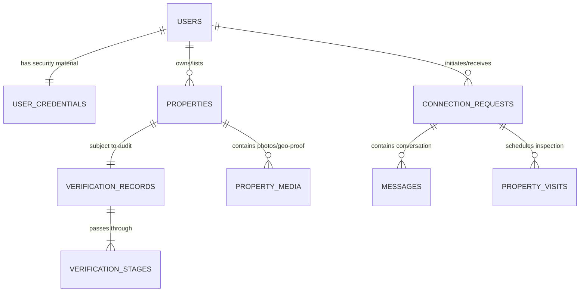

# Griha Saathi — Production Database Architecture & Data Schema

This document details the entity-relationship model, access patterns, integrity constraints, and security guarantees for **Griha Saathi**.

---

## 1. Core Principles

1. **Zero Synthetic Records**: Tables are designed for live, verified data only. No mock records or seeded filler properties exist in migrations or baseline stores.
2. **Separation of Authentication Material**: Security PIN hashes and OTP challenges reside in isolated tables (`user_credentials`, `otp_challenges`), preventing leakage during general profile retrieval.
3. **Audit Trail & Immutability**: All verification stages and statutory inspections are captured in dedicated audit tables (`verification_records`, `verification_stages`, `audit_logs`).
4. **Digital Personal Data Protection (DPDP) Act 2023 Alignment**: Identifiers are masked in frontend queries, purpose-specific consent is logged, and full-name fields are strictly optional until identity verification occurs.

---

## 2. Entity Relationship Overview

---

## 3. Detailed Entity Definitions

### `users`
- Stores member accounts.
- `identifier`: Normalized Indian mobile number (E.164 without spaces) or lowercase email address.
- `phone`: Verified Indian mobile number (+91).
- `email`: Verified email address.
- `active_role`: Current operational context (`tenant`, `owner`, `agent`, `builder`, `property_manager`).
- `full_name`: Voluntarily supplied name. Never fabricated or defaulted with synthetic names.
- `preferred_language`: Preferred interface language (`en`, `hi`, `hi-en`).
- `avatar_url`: Profile photo URL or secure asset pointer.
- `notification_preferences`: JSONB storing granular email, SMS, inquiry, and security preferences.

### `user_roles` (Multi-Role Support)
- Junction table allowing one account to hold multiple roles simultaneously (e.g. both Tenant and Property Owner).
- Users can switch their `active_role` dynamically; backend authorization checks `user_roles` to ensure the user actually possesses the role.

### `user_credentials`
- `pin_hash`: Salted bcrypt (cost factor = 10) hash of the user's 4-digit numeric PIN. Never stored in plaintext.
- `failed_pin_attempts`: Counter triggering progressive throttling and 15-minute lockouts upon 5 consecutive failures.
- `locked_until`: Expiry timestamp for lockouts.
- `pin_changed_at`: Timestamp tracking last PIN change (triggers session revocation).

### `user_sessions`
- Server-side session store tracking active sessions and device tokens.
- Supports `HttpOnly`, `SameSite`, and `Secure` cookie session persistence and Authorization Bearer header.
- Allows user to view all active devices and revoke other sessions.

### `otp_challenges`
- `otp_hash`: Bcrypt hash of the cryptographically generated 6-digit OTP (`crypto.randomInt(100000, 1000000)`). Plaintext OTP is NEVER stored and NEVER logged.
- `challenge_type`: Differentiates `'registration'`, `'recovery'`, and `'contact_update'`.
- `expires_at`: Strict 5-minute TTL.
- `attempts_remaining`: Decrements on every incorrect attempt; invalidated at 0.
- `last_requested_at`: Enforces 60-second cooldown between resend requests.
- `request_count_in_window`: Enforces max 5 OTP requests per hour per contact identifier.
- `verification_token`: Single-use cryptographic token (32 bytes hex) issued after successful OTP verification, consumed when establishing or resetting the PIN.

### `properties`
- Core rental unit entity.
- Target regions constrained to initial 5 territories: `Delhi`, `Haryana`, `Punjab`, `Himachal Pradesh`, `Jammu & Kashmir`.
- Filtered by `verification_status = 'authoritative_verified'` in public discovery queries. Properties with `pending_review` or `unverified` statuses remain hidden from public search until verified.
- **Phase 4 Discovery Extensions**:
  - `bedrooms`: Number of bedrooms (BHK).
  - `bathrooms`: Number of bathrooms.
  - `area_sq_ft`: Carpet or built-up area in square feet.
  - `maintenance_charges`: Recurring monthly maintenance fee.
  - `availability_status`: Real state (`available`, `under_maintenance`, `occupied`).
  - `availability_confirmed_at`: Timestamp of last owner or field audit reconfirmation.
  - `geo_latitude`, `geo_longitude`: Certified GPS coordinates for cadastral mapping.
  - `data_source`: Origin tracking (`owner_submission`, `authorized_registry`, `licensed_agent`).
- **60-Day Freshness Rule**:
  - Any listing with `NOW() - availability_confirmed_at > 60 days` is evaluated as stale. Public search badges it as `Pending Reconfirmation` and filters it out when `confirmedAvailableOnly=true` is requested.
  - Property owners and platform administrators can invoke `POST /api/properties/:id/reconfirm-availability` to refresh the 60-day window.

### `saved_properties` (User Bookmarks)
- Junction table managing real-property bookmarks for authenticated users.
- `user_id`: Reference to the saving member account.
- `property_id`: Reference to the authentic property listing.
- `saved_at`: Timestamp of bookmark creation.
- Strict uniqueness constraint `UNIQUE(user_id, property_id)` prevents duplicate bookmarks.
- Indexed by `(user_id, saved_at DESC)` for efficient, user-isolated retrieval.
- Transparently handles unlisted or expired properties without generating synthetic substitutes.

### `verification_records` & `verification_stages`
- Tracks the 4 mandatory audit stages:
  1. `land_registry`: Cross-audit against state revenue portals (Jamabandi, PLRS, DDA, Himbhoomi, J&K Land Records).
  2. `physical_inspection`: On-site field officer inspection with geo-tagged photographic evidence.
  3. `owner_identity`: DigiLocker / Aadhaar identity cross-match with ownership deed.
  4. `police_intimation`: Digital tenant intimation filing with state police citizen portals.

### `connection_requests` & `messages`
- Direct tenant-to-landlord communication.
- Enforces authenticated access control: only the participating tenant and property owner can read or post messages.

### `audit_logs`
- Tamper-resistant security audit trail capturing user identity events:
  - Account registrations, successful/failed logins, 15-minute lockouts, PIN resets, PIN updates, role switches, contact updates, session revocations, property bookmarks (`save_property`, `unsave_property`), availability reconfirmations, and listing state changes.

### `listing_drafts` (Phase 5)
- Server-side persisted property listing wizard drafts with strict user isolation:
  - `id`: Unique draft identifier (`draft_<uuid>`).
  - `user_id`: Reference to authenticated submitter.
  - `current_step`: Step reached in the 7-step wizard (1-7).
  - `draft_data`: Full JSONB payload preserving entered fields across steps.
  - `created_at`, `updated_at`: Audit timestamps.

### `property_media` (Phase 5)
- Publicly accessible genuine photographs:
  - `id`: Media tracking identifier (`img_<uuid>`).
  - `property_id`: Foreign key to `properties(id)`.
  - `url`: Direct static path (`/uploads/photos/...`).
  - `filename`, `original_filename`: Storage and user-uploaded filenames.
  - `file_size_bytes`, `mime_type`: Validated size (max 5MB) and MIME type (`image/jpeg`, `image/png`, `image/webp`).
  - `sha256_hash`: Cryptographic digest.

### `property_documents` (Phase 5 - DPDP Private Access)
- Encrypted ownership evidence documents strictly restricted from public discovery:
  - `id`: Document tracking identifier (`doc_<uuid>`).
  - `property_id`: Foreign key to `properties(id)`.
  - `document_type`: Registered category (`title_deed`, `sale_deed`, `jamabandi`, `property_tax_receipt`, `power_of_attorney`, `lease_agreement`, `other`).
  - `sha256_hash`: 64-character SHA-256 integrity digest computed on upload.
  - `access_role`: Strictly `'owner_and_verifier_only'`.
  - `status`: Verification state (`pending_review`, `verified`, `rejected`).
  - `rejection_reason`: Clear reason if document failed statutory audit.

### `listing_status_history` (Phase 5)
- Immutable chronological audit trail recording every state transition:
  - `id`: Status transition ID (`st_<uuid>`).
  - `property_id`: Foreign key to `properties(id)`.
  - `from_status`, `to_status`: Workflow states (`draft`, `submitted`, `pending_verification`, `under_review`, `correction_requested`, `resubmitted`, `approved`, `rejected`, `expired`, `withdrawn`).
  - `changed_by`: User ID of actor performing the transition.
  - `changed_at`: Timestamp of transition.
  - `reason`: Required rationale (e.g. for correction requests or withdrawals).
  - `comments`: Optional notes.
  - **Self-Approval Invariant**: Server-side validation strictly prevents property owners from approving their own property verifications, even if the owner account possesses administrator or verifier roles.

### `fraud_reports` (Phase 6 - Trust & Safety)
- User-submitted reports regarding suspected fraud, fake advertisements, or fee misrepresentation:
  - `id`: Report ID (`rep_<uuid>`).
  - `property_id`: Foreign key to `properties(id)`.
  - `reporter_id`: Foreign key to `users(id)`, isolated server-side and never disclosed to owners or in public API responses (DPDP Act 2023 compliance).
  - `reporter_masked_contact`: Pre-masked identifier for moderator review (e.g., `+91 98*** **321`).
  - `reason`: Standardized classification (`suspected_fake_listing`, `misrepresented_rent_or_charges`, `unauthorized_advertisement`, `suspicious_payment_request`, `misleading_photos_or_description`, `duplicate_listing`, `impersonation_fraud`, `other`).
  - `description`: Detailed explanation from reporter.
  - `status`: Moderation state (`pending`, `under_investigation`, `action_taken`, `dismissed`).
  - `moderator_notes`: Internal notes visible only to verified moderators.
  - `moderator_action`: Action outcome (`none`, `warning_issued`, `listing_suspended`, `owner_banned`).
  - **Anti-Spam Invariant**: Rate-limiting ensures a user cannot submit duplicate pending reports on the same property within a 24-hour window, while preserving the ability to report distinct listings.

### `listing_appeals` (Phase 6 - Dispute Handling)
- Formal appeal mechanism for property owners facing adverse decisions:
  - `id`: Appeal record identifier (`app_<uuid>`).
  - `property_id`: Property under dispute.
  - `owner_id`: Account claiming ownership/authorization.
  - `reason`: Substantive justification and clarification provided by the submitter.
  - `supporting_document_urls`: Array of evidence URLs or document hashes.
  - `status`: Appeal review state (`pending`, `under_review`, `accepted`, `rejected`).
  - `reviewer_notes`: Mandatory feedback recorded by the auditor.
  - `reviewed_by`, `reviewed_at`: Audit attribution and timestamp.
  - **Self-Resolution Invariant**: An owner who holds an administrator or verifier role cannot resolve their own property's appeal.

### `in_app_notifications` (Phase 6 & 7 - Real-Time Workflow, Connection & Visit Alerts)
- Real-time in-app notifications delivering verifiable workflow updates:
  - `id`: Notification tracking ID (`notif_<uuid>`).
  - `user_id`: Target recipient account ID.
  - `title`, `message`: Clear, factual status update.
  - `type`: Category (`submission`, `review`, `correction`, `approval`, `rejection`, `suspension`, `appeal`, `freshness`, `connection_request`, `connection_accepted`, `connection_declined`, `new_message`, `visit_requested`, `visit_confirmed`, `visit_declined`, `visit_rescheduled`, `visit_cancelled`).
  - `related_property_id`: Optional property linkage.
  - `related_connection_id`: Optional connection request linkage.
  - `related_visit_id`: Optional property visit linkage.
  - `is_read`: Boolean read status flag.
  - `created_at`: Event timestamp.

### `connection_requests` (Phase 7 - Verified Connections)
- Authoritative contact connection requests between platform participants:
  - `id`: Connection identifier (`conn_<uuid>`).
  - `sender_id`: User initiating the connection request.
  - `recipient_id`: Recipient user (e.g., property owner or listing agent).
  - `property_id`: Optional associated property listing.
  - `status`: Connection state (`pending`, `accepted`, `declined`, `cancelled`, `blocked`).
  - `initial_message`: Introductory message text.
  - `created_at`, `updated_at`: Timestamp tracking.
  - **Invariants**: Self-connections are strictly rejected (`sender_id <> recipient_id`). Requests to blocked users or from blocked users are prevented. Multiple simultaneous active connections for the same property/parties are rejected.

### `conversation_messages` (Phase 7 - Secure Messaging)
- Database-persisted end-to-end messaging for authorized connections:
  - `id`: Message identifier (`msg_<uuid>`).
  - `connection_id`: Foreign key to `connection_requests(id)`.
  - `sender_id`: User ID of message author.
  - `content`: Message payload (length 1–2,000 characters).
  - `is_read`: Boolean delivery and read acknowledgment.
  - `read_at`: Timestamp when recipient opened the thread.
  - `is_reported`: Boolean flag indicating abuse report.
  - `report_reason`, `reported_at`: Abuse tracking details.
  - `created_at`: Message dispatch timestamp.
  - **Invariants**: Messaging is restricted exclusively to connections in `accepted` state. Rate limiting enforces a maximum of 30 messages/minute per sender. Cross-conversation access is strictly blocked at the route and database layers.

### `property_visits` (Phase 7 - Physical Visit Scheduling)
- Property inspection appointments with strict conflict prevention:
  - `id`: Visit identifier (`visit_<uuid>`).
  - `connection_id`: Associated connection identifier.
  - `property_id`: Verified property listing ID.
  - `visitor_id`: Requesting prospective tenant.
  - `owner_id`: Property owner or authorized agent.
  - `status`: Lifecycle state (`pending`, `confirmed`, `rescheduled`, `completed`, `cancelled`).
  - `preferred_date`: Inspection date (must be current or future).
  - `time_slot`: Requested slot (`morning_10_12`, `afternoon_2_4`, `evening_4_6`, `evening_6_8`).
  - `proposed_alternative_date`, `proposed_alternative_time_slot`, `reschedule_note`: Negotiation parameters when counter-offered.
  - `notes`: Visitor notes or requirements.
  - `cancellation_reason`: Mandatory reason upon cancellation.
  - `cancelled_by`: User ID of cancelling party.
  - `status_history`: Chronological audit log of state changes.
  - `created_at`, `updated_at`: Timestamps.
  - **Invariants**: Self-visits are forbidden (`visitor_id <> owner_id`). Past dates are rejected. Duplicate active bookings by the same visitor for the same property are prevented. Conflicting confirmed visits for the same property and time slot are rejected.

### `blocked_users` (Phase 7 - Harassment Prevention & Safety)
- Direct user-to-user blocking records:
  - `id`: Block identifier (`blk_<uuid>`).
  - `blocker_id`: User establishing the block.
  - `blocked_id`: User being blocked.
  - `reason`: Optional recorded rationale.
  - `created_at`: Block initiation timestamp.
  - **Invariants**: Self-blocking is rejected (`blocker_id <> blocked_id`). Blocking immediately terminates active connections and suppresses any inbound messages, requests, or notifications.

